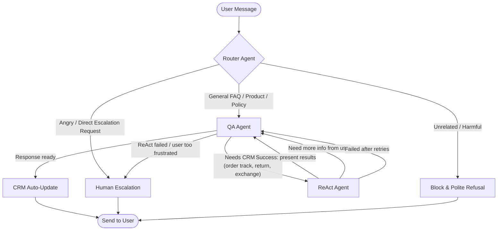

# Implementation Plan: Nuit Customer Support Bot v2

## Architecture Overview



### Routing Rules Summary

| Source | Target | Condition |
|--------|--------|-----------|
| Router | QA | General inquiry, FAQ, product questions, policy questions |
| Router | Escalation | High anger detected, explicit "talk to human" request |
| Router | Block | Unrelated/harmful content |
| QA | ReAct | User needs CRM action (WISMO, return, exchange, billing) |
| QA | Escalation | ReAct failed + can't resolve, or user escalating mid-convo |
| QA | END | FAQ answered successfully |
| ReAct | QA | Always returns to QA (with results, missing params, or failure) |
| Escalation | END | After generating report + writing to queue |

---

## State Redesign

### Current State Issues
- `rag_output` and `agent_queries` — **Remove** (no more RAG)
- `process_state` is a flat string — **Replace** with per-agent status tracking
- `ReactState.output` is untyped `dict` — **Type it properly**
- No `final_response` field — QA response is buried in messages
- No turn counter for guardrails

### Recommended New State

```python
from typing import Annotated, Literal
from typing_extensions import TypedDict
from langgraph.graph.message import add_messages
from langchain_core.messages import BaseMessage
from pydantic import BaseModel

# --- Structured Outputs (Pydantic for validation + retries) ---

class RouterOutput(BaseModel):
    next_agent: Literal["qa", "escalate", "block"]
    sentiment: Literal["neutral", "positive", "frustrated", "angry"]
    classification: Literal[
        "general_inquiry", "order_tracking", "return_exchange",
        "product_question", "billing", "unrelated", "greeting"
    ]
    reasoning: str  # brief explanation for LangSmith visibility

class ReactResult(BaseModel):
    status: Literal["success", "need_info", "failed"]
    tool_output: dict | None          # raw CRM result if success
    missing_params: list[str] | None  # what's needed from user
    reasoning: str                    # step-by-step plan for tracing
    failure_reason: str | None        # why it failed, if applicable

class EscalationReport(BaseModel):
    reason: Literal[
        "customer_anger", "react_failure", "direct_request",
        "user_stalling", "repeated_failure"
    ]
    chat_summary: str
    urgency: float  # 0.0 to 1.0
    collected_metadata: dict  # phone, order_id, name, etc.
    recommended_actions: list[str]

# --- Graph State ---

class AgentState(TypedDict):
    # Conversation history (auto-merged via add_messages)
    messages: Annotated[list[BaseMessage], add_messages]

    # Router output
    router_output: RouterOutput | None

    # QA <-> ReAct coordination
    qa_directive: str  # "answer" | "delegate_to_react" | "present_results" | "ask_for_params" | "escalate"
    react_request: str | None       # what QA wants ReAct to do
    react_result: ReactResult | None

    # Escalation
    escalation_report: EscalationReport | None

    # CRM auto-update
    learned_user_info: dict  # {name, phone, zone, preferences...}

    # Guardrails
    react_turn_count: int  # max 3 per conversation turn

    # Final output
    final_response: str  # the WhatsApp-formatted message to send
```

### Key Changes from Current
1. **Pydantic models** for all structured outputs (enables validation retries)
2. **`qa_directive`** replaces `qa_mode` — clearer semantics
3. **`react_result`** is a proper typed model, not a raw dict
4. **`react_turn_count`** for loop guardrails (max 3)
5. **`final_response`** explicitly captures the output message
6. **Removed**: `rag_output`, `agent_queries`, `process_state`

---

## Phase 1: Infrastructure & Graph Skeleton

> **Goal**: Runnable graph with stub nodes, LangSmith tracing, CLI with threaded sessions

### 1.1 LangSmith Tracing Setup
- Set `LANGSMITH_TRACING=true` in `.env`
- Configure project name: `nuit-bot-v2`
- Every node function decorated with `@traceable` (name matches node name)
- LLM calls automatically traced via `langchain` integration
- Tool calls traced via `@tool` decorator (already handled by langchain)
- **What gets traced**: every LLM call (tokens, latency, model), every tool invocation (input/output), every node execution (state in -> state out), full graph run (start to finish)

### 1.2 Project Structure (in-place refactor of `core_agent/`)
```
core_agent/
├── __init__.py
├── graph.py              # Graph compilation + entry point (replaces chatbot.py)
├── state.py              # New AgentState + Pydantic models
├── nodes/
│   ├── __init__.py
│   ├── router.py         # Router agent node
│   ├── qa_agent.py       # QA agent node (rewritten)
│   ├── react_agent.py    # ReAct agent node (new)
│   ├── escalation.py     # Human escalation node (new)
│   ├── crm_updater.py    # CRM auto-update node (new)
│   └── blocker.py        # Unrelated/harmful block node (new)
├── tools/
│   ├── __init__.py
│   └── mock_crm.py       # Mock CRM tools (refactored from tools.py)
├── prompts/
│   ├── router.md
│   ├── qa_agent.md        # Rewritten with hardcoded FAQ/policies/brand voice
│   ├── react_agent.md
│   └── escalation.md
└── docs/                  # Knowledge base files (kept as reference only)
```

### 1.3 CLI Entry Point
- Refactor `cli_chat.py` to use new graph
- Generate UUID session ID on start
- Print session ID so user can resume (future)
- Show which agent handled each turn (for debugging)

### 1.4 Deliverables
- [ ] New `state.py` with all Pydantic models
- [ ] `graph.py` with compiled graph (stub nodes that pass through)
- [ ] LangSmith tracing verified (see traces in dashboard)
- [ ] CLI chat working end-to-end with stubs
- [ ] Mock CRM tools refactored into `tools/mock_crm.py`

---

## Phase 2: Core Agents — Router + QA + Escalation + Blocker

> **Goal**: Router classifies and routes. QA answers FAQs with hardcoded knowledge. Escalation generates reports. Basic happy path works.

### 2.1 Router Agent
- **Input**: Latest user message + recent history (last 4 messages for context)
- **Output**: `RouterOutput` (Pydantic structured output)
- **LLM call**: Uses `model.with_structured_output(RouterOutput)`
- **Validation retry**: If Pydantic parsing fails, retry up to 2 times with error feedback
- Detects sentiment, classifies intent, decides next agent
- Does NOT answer questions — only routes

### 2.2 QA Agent
- **System prompt includes hardcoded**:
  - Brand voice guidelines (from `brand_identity.md` — tone section only)
  - FAQ content (from `faq.md`)
  - Policies content (from `terms_of_conditions_and_policies.md`)
  - Customer service SOP rules (from `customer_service_sop.md`)
  - WhatsApp formatting rules
  - Bilingual instructions (English + Arabic Egyptian dialect + MSA)
- **Input**: Full message history + router output context (sentiment, classification)
- **Output**: Response text formatted for WhatsApp
- **In this phase**: Only handles direct FAQ/policy answers. No ReAct delegation yet.
- **Fallback**: If can't answer, sets `qa_directive = "escalate"`

### 2.3 Human Escalation Agent
- **Input**: Full message history + any collected metadata
- **Output**: `EscalationReport` (Pydantic structured output)
- Generates urgency score, chat summary, recommended actions
- Writes report to escalation queue (mock: append to a JSON file or SQLite table)
- Returns a polite handoff message to the user

### 2.4 Blocker Node
- Simple node (no LLM needed)
- Returns a polite refusal message for unrelated/harmful content
- Logs the blocked message for review

### 2.5 Deliverables
- [ ] Router agent with structured output + validation retries
- [ ] QA agent with hardcoded knowledge base in system prompt
- [ ] Human Escalation agent with report generation + queue write
- [ ] Blocker node
- [ ] Full Router -> QA -> END flow working
- [ ] Full Router -> Escalation -> END flow working
- [ ] Full Router -> Block -> END flow working
- [ ] LangSmith traces showing full pipeline with token counts

---

## Phase 3: ReAct Agent & Bidirectional QA <-> ReAct

> **Goal**: ReAct agent handles CRM operations. QA delegates to ReAct and presents results. Loop guardrails prevent infinite cycles.

### 3.1 ReAct Agent
- **System prompt**: Reasoning-first instructions (plan before acting)
- **Tools available**: `mock_crm_tool` (lookup_order, register_return, register_exchange)
- **Execution flow**:
  1. Receives task from QA via `react_request`
  2. Writes a step-by-step reasoning plan
  3. Checks if all params are present in message history
  4. If missing params: returns `ReactResult(status="need_info", missing_params=[...])`
  5. If all params present: calls tool, returns `ReactResult(status="success", tool_output={...})`
  6. If tool fails: returns `ReactResult(status="failed", failure_reason="...")`

### 3.2 QA <-> ReAct Coordination
- QA decides to delegate when classification is `order_tracking` or `return_exchange`
- QA sets `qa_directive = "delegate_to_react"` and `react_request = "..."` 
- After ReAct returns:
  - `success` -> QA presents results in brand voice (`qa_directive = "present_results"`)
  - `need_info` -> QA asks user for missing params (`qa_directive = "ask_for_params"`)
  - `failed` -> QA tries to help, or escalates (`qa_directive = "escalate"`)

### 3.3 Graph Edges for ReAct Loop
```python
# Conditional: QA decides what to do next
def after_qa(state) -> str:
    if state["qa_directive"] == "delegate_to_react":
        return "react"
    if state["qa_directive"] == "escalate":
        return "escalation"
    return "crm_update"  # -> END

# ReAct always returns to QA
workflow.add_edge("react", "qa")

# Guardrail: max 3 ReAct invocations per turn
# Enforced inside the QA node: if react_turn_count >= 3, force escalate
```

### 3.4 Loop Guardrails
- `react_turn_count` incremented each time ReAct is invoked
- Max 3 ReAct calls per user turn
- If exceeded: QA forces escalation
- Stalling detection: if user refuses to provide info for 2 consecutive turns, escalate

### 3.5 Deliverables
- [ ] ReAct agent with tool calling and reasoning plan
- [ ] QA -> ReAct delegation working
- [ ] ReAct -> QA result presentation working
- [ ] ReAct -> QA param collection working
- [ ] ReAct failure -> Escalation path working
- [ ] Loop guardrails enforced
- [ ] LangSmith traces showing full QA <-> ReAct loop

---

## Phase 4: CRM Auto-Update & Polish

> **Goal**: Extract user info from conversations and update CRM. Handle edge cases.

### 4.1 CRM Auto-Update Node
- Runs after QA produces final response (before END)
- Uses a lightweight LLM call to extract any NEW user info from the conversation:
  - Name, phone, delivery zone, product preferences, order IDs mentioned
- Compares against `learned_user_info` from state to avoid redundant updates
- Calls `mock_crm_tool` to persist (or a simple dict/SQLite write)
- **Only fires if there is actually new info** — no empty updates

### 4.2 Edge Case Handling
- User switches language mid-conversation (Arabic <-> English)
- User asks multiple questions in one message
- User sends just an emoji or attachment reference
- ReAct tool returns unexpected data format
- LLM returns invalid structured output (Pydantic retry logic)

### 4.3 Deliverables
- [ ] CRM auto-update node extracting user info
- [ ] Mock CRM write confirmed in traces
- [ ] Edge case handling tested
- [ ] Full end-to-end flow polished

---

## Phase 5: Testing & Evaluation

> **Goal**: Comprehensive test suite from unit tests to LLM-as-a-judge evals.

### 5.1 Layer 1 — Unit Tests (pytest)
Standard code tests, no LLM calls needed:
- **State validation**: Pydantic models accept valid data, reject invalid
- **Mock CRM tools**: Correct outputs for all action types, edge cases (missing order, wrong phone)
- **Graph structure**: Correct nodes registered, correct edges, entry point set
- **Blocker node**: Returns refusal for unrelated content
- **Guardrails**: `react_turn_count` enforcement logic

### 5.2 Layer 2 — Integration Tests (pytest + real LLM)
Full graph execution with real LLM calls:
- **Happy path scenarios**:
  - User asks FAQ -> Router -> QA -> correct answer
  - User asks order status -> Router -> QA -> ReAct -> QA -> presents result
  - User is angry -> Router -> Escalation -> report generated
  - User asks unrelated question -> Router -> Block
- **Multi-turn scenarios**:
  - User asks FAQ, then follows up -> thread state preserved
  - User starts order tracking, provides phone across 2 turns -> ReAct collects params
- **Failure scenarios**:
  - ReAct tool fails -> escalation triggered
  - Invalid order ID -> appropriate error message
  - ReAct loops 3 times -> guardrail kicks in

### 5.3 Layer 3 — Dataset-Generated Criteria (LangSmith Datasets)
- Create a **LangSmith dataset** with labeled test cases:
  - ~15 FAQ questions with expected answers (grounded in hardcoded docs)
  - ~10 order tracking scenarios with expected CRM lookups
  - ~5 return/exchange scenarios
  - ~5 escalation scenarios  
  - ~5 unrelated/harmful inputs
  - ~5 Arabic language inputs
- Each dataset row: `{input, expected_output, metadata}` where metadata has tags for category, language, expected_agent_path

### 5.4 Layer 4 — LLM-as-a-Judge Evaluators (LangSmith)
Custom evaluators registered in LangSmith:

| Evaluator | What it checks | Score |
|-----------|---------------|-------|
| **Factual Grounding** | Every price/policy/date matches hardcoded docs | 0-1 binary |
| **Brand Voice** | Tone is luxury, professional, concise (3 sentences max) | 1-5 scale |
| **WhatsApp Format** | No `**bold**`, no `#` headers, no emojis | 0-1 binary |
| **Routing Accuracy** | Router sent to correct agent | 0-1 binary |
| **Helpfulness** | Did the response actually help the user's request | 1-5 scale |
| **Scope Compliance** | Didn't answer unrelated questions | 0-1 binary |
| **Language Match** | Responded in the same language the user used | 0-1 binary |

### 5.5 Test File Structure
```
backend/
├── tests/
│   ├── __init__.py
│   ├── test_state.py          # Pydantic model validation
│   ├── test_mock_crm.py       # Tool unit tests
│   ├── test_graph_structure.py # Graph compilation tests
│   ├── test_integration.py    # Full flow tests with LLM
│   ├── test_multi_turn.py     # Thread persistence tests
│   ├── eval/
│   │   ├── dataset.json       # LangSmith evaluation dataset
│   │   ├── evaluators.py      # LLM-as-a-judge evaluator functions
│   │   └── run_evals.py       # Script to run evals against LangSmith
│   └── conftest.py            # Shared fixtures
```

### 5.6 Deliverables
- [ ] Unit tests passing (pytest)
- [ ] Integration tests passing (real LLM)
- [ ] LangSmith dataset uploaded
- [ ] LLM-as-a-judge evaluators registered
- [ ] Eval results dashboard in LangSmith

---

## Tech Stack Summary

| Component | Technology |
|-----------|-----------|
| Graph framework | LangGraph |
| LLM provider | GitHub Models API (`models.github.ai`) |
| Model | `openai/gpt-4.1-mini` (single model for now, supports per-agent models later) |
| Tracing | LangSmith (full traces: LLM calls, tools, nodes, tokens, latency) |
| Structured output | Pydantic `BaseModel` + `model.with_structured_output()` |
| Thread persistence | `MemorySaver()` (in-memory, upgrade to SQLite/Postgres later) |
| Session IDs | UUID4 generated per CLI session |
| CRM | Mock tools (dict-based, no real DB) |
| Escalation queue | Mock (JSON file or in-memory list) |
| Testing | pytest + LangSmith evaluations |
| Language | Python 3.12+ |
