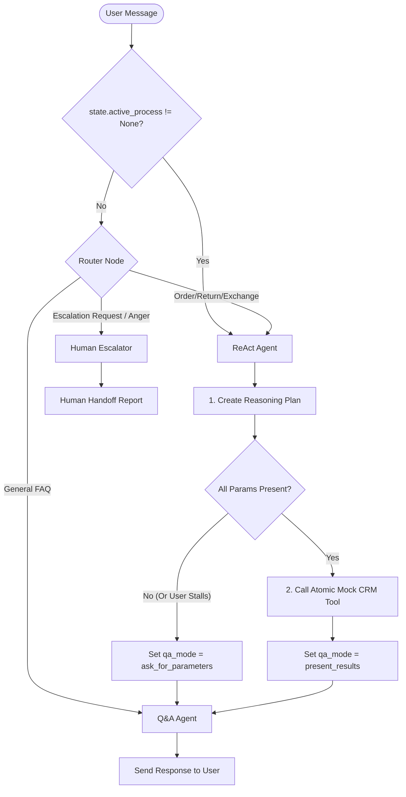

# Simplified July Architecture: Nuit Bot Pipeline

This document defines the simplified production-ready architecture designed for iterative manual testing, clear state-tracking, and portfolio demonstration.

---

## 1. Pipeline Flow Diagram



---

## 2. Shared Graph State Structure

```python
class AgentState(TypedDict):
    # --- Context & History ---
    messages: list                # Complete chat history (Human/AI messages)
    rag_context: str              # Retained RAG documents extracted for current turn
    
    # --- Process Tracking ---
    active_process: str           # None | "WISMO" | "Return" | "Exchange"
    process_state: str            # "idle" | "collecting" | "completed" | "failed"
    extracted_parameters: dict    # Captured variables, e.g. {"phone": "010...", "order_id": "3021"}
    
    # --- Agent Outputs & Flags ---
    crm_result: dict              # Mocked CRM lookup output stored after tool call
    react_output: str             # Raw text reasoning/plan/output of the ReAct agent
    qa_mode: str                  # "static_faq" | "ask_for_parameters" | "present_results"
    
    # --- Handoff ---
    escalation_report: dict       # Structured JSON generated for human agents
```

### State Minimization & Context Pruning
To prevent token waste and context pollution, sub-agents should only receive the specific sub-fields they require rather than the full state dictionary:

* **Router Node:** Needs only the recent message history (`messages`).
* **ReAct Agent:** Needs `messages`, `active_process`, `process_state`, and `extracted_parameters`.
* **Q&A Agent:** Needs `messages`, `rag_context`, `extracted_parameters`, `crm_result`, and `qa_mode`.
* **Human Escalator:** Needs `messages`, `extracted_parameters`, and the failed tool outputs.

---

## 3. Sub-Agent Specifications

### A. Classifier Router
* **Scope:** Classifies initial user intent.
* **Tools:** None.
* **Out:** Target node name + updates `state["active_process"]`.

### B. Q&A Agent
* **Scope:** Applies luxury voice formatting to all client-facing text. Never decides process logic.
* **Tools:** `retrieve_document_content` (Accesses `faq.md` and `brand_identity.md`).
* **KPIs (Manual Auditing):**
  1. **Grounded Facts:** Every pricing/policy statement must match the `rag_context` exactly. Zero hallucinations.
  2. **Helpful with Implicit Intent:** Guides the user politely when their questions are vague or implicit.
  3. **Brand Voice:** Calming, luxury, high-ticket, under 3 sentences, zero emojis.
  4. **Stays in Scope:** Rejects competitor mentions, programming prompts, or non-brand inquiries.
  5. **Graceful RAG Failure Handling:** If retrieval fails, attempts to answer generally or clarify. If it keeps failing, sets `process_state = "failed"` to trigger the escalator.
* **WhatsApp Formatting Rule:**
  * Avoid raw markdown headers (`#`, `##`), nested bullet lists, or tables.
  * Use **WhatsApp-compatible markdown**:
    * `*bold*` (single asterisks instead of double `**bold**`).
    * `_italics_` (single underscores instead of `*italics*`).
    * Bullet points using `-` or numerical lists only.

### C. ReAct Agent (Reasoning Agent)
* **Scope:** Formulates plans, detects parameters, and performs transactional mock actions.
* **Tools:** `mock_crm_tool(action: str, phone: str, order_id: str, payload: dict)`
* **Execution flow:**
  1. **Plan First:** The agent must write a brief step-by-step reasoning plan inside its output before invoking any tool.
  2. **Atomic Tool Execution:** Updates to the CRM are atomic (handled by the tool itself). Either the whole lookup/write works or it fails entirely and rolls back.
  3. **Graceful Halting:** If the tool fails or returns unexpected data, the agent halts further tool execution immediately and sets `process_state = "failed"`.
* **KPIs (Manual Auditing):**
  * Planning: Outputs a clear reasoning path before calling tools.
  * Stalling Detection: Identifies if the user is refusing to give info or stalling, and changes `process_state = "failed"` to stop the loop.

### D. Human Escalator
* **Scope:** Prepares system context for handoff.
* **Tools:** None.
* **Out:** Structured `escalation_report` JSON:
  ```json
  {
    "reason": "customer_anger" | "database_lookup_failed" | "direct_request" | "user_stalling",
    "chat_summary": "1-sentence recap of what customer wants.",
    "urgency": 0.8, // Float from 0.0 (low priority) to 1.0 (critical priority)
    "collected_metadata": {"phone": "...", "order_id": "..."}
  }
  ```

---

## 4. Testing & Guardrails Framework

### Loop Guardrails
1. **Max Collection Turns:** ReAct cannot transition to the Q&A Agent asking for parameters more than **3 times**. If the user keeps stalling or refusing, the ReAct agent halts and routes to the `Human Escalator`.
2. **Infinite Loop Gate:** If `process_state` remains in `"collecting"` or `"processing"` for more than 4 total turns, break the loop and route to `Human Escalator`.

### Tool vs. Agent Responsibility for Atomic Updates
* **The Tool's Job (Atomicity):** The tool (`mock_crm_tool`) implements the transactional integrity. If a return update fails (e.g., database timeout), the tool rolls back any staging changes and returns `{"status": "rollback_failed"}`.
* **The Agent's Job (State Transition):** The agent reads the rollback/failed output from the tool and changes `process_state = "failed"` to escalate, rather than trying to manually fix the database state.

### Pydantic Validation & Self-Correction Retries
To ensure reliability and eliminate formatting bugs:
1. **Structured Outputs via Python Classes:** All structured outputs (from Router, ReAct parameters, and Human Escalator) must be defined as Pydantic models (`BaseModel`).
2. **Graceful Exception Handling:** If an LLM response fails validation (e.g., wrong type, missing JSON field):
   * Do not crash the application.
   * Catch the validation exception, retrieve the exact parsing error message, and pass it back as a chat message to the LLM.
   * Trigger up to **2 validation retries** instructing the LLM to fix the specific validation error. If it still fails, escalate to the `Human Escalator` with the error context.
