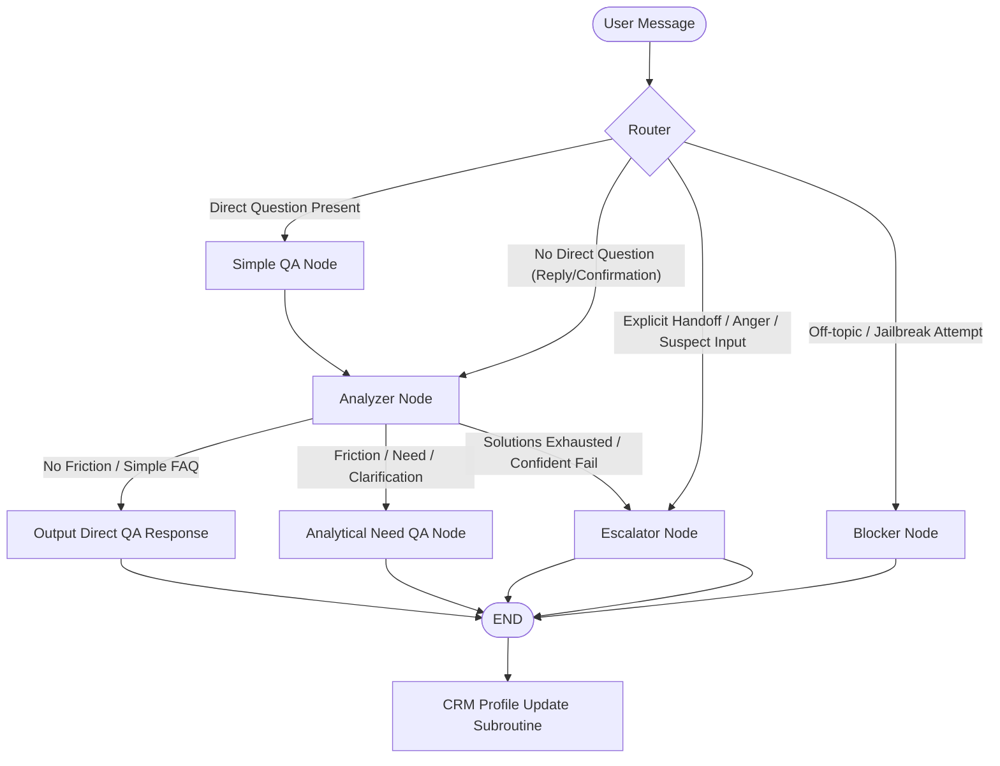

# QA & Profiler Agent Pipeline Implementation Walkthrough

This walkthrough outlines the implementations completed to establish the unstructured customer profiling, conditional QA routing, and direct tool execution framework within NuitBot.

## Architectural Structure Setup

## Changes Completed

### 1. State Definition
- **[state.py](file:///home/hendawy/Documents/career/projects/customer-support-bot/backend/core_agent/state.py):** Added the `AnalyzerMetadata` TypedDict schema (containing `knowledge_graph`, `directive`, `evidence`, and `proposed_solutions`) and updated `ServiceBotState` to include `simple_qa_response` and `analyzer_metadata`.

### 2. CRM & Execution Tools
- **[tools/__init__.py](file:///home/hendawy/Documents/career/projects/customer-support-bot/backend/core_agent/tools/__init__.py):** Implemented and exported the `@tool` wrapper `lookup_crm_profile(phone: str)` to allow the analyzer agent to pull user profiles dynamically.

### 3. High-Level XML Prompts
- **[analyzer.md](file:///home/hendawy/Documents/career/projects/customer-support-bot/backend/core_agent/prompts/analyzer.md):** Created a high-level XML system prompt explaining variables to detect, tool usage rules (calling CRM details or executing exchanges/returns directly when agreed), decision directives, and Turn-Fatigue constraints.
- **[need_qa.md](file:///home/hendawy/Documents/career/projects/customer-support-bot/backend/core_agent/prompts/need_qa.md):** Created a high-level XML system prompt outlining how the analytical QA agent combines cached responses and workarounds in a luxurious brand voice.
- **[router.md](file:///home/hendawy/Documents/career/projects/customer-support-bot/backend/core_agent/prompts/router.md):** Updated to a high-level XML prompt template detailing routing directives (routing to `simple_qa` when direct questions exist, `analyzer` when absent, and direct human escalation or blocking for angry or suspicious inputs).
- **[simple_qa.md](file:///home/hendawy/Documents/career/projects/customer-support-bot/backend/core_agent/prompts/simple_qa.md):** Updated to a high-level XML prompt template directing the Simple QA responder to output direct answers only.

### 4. Graph Compiled Nodes
- **[analyzer.py](file:///home/hendawy/Documents/career/projects/customer-support-bot/backend/core_agent/nodes/analyzer.py):** Created the profiler agent node using a Pydantic structured output model (`AnalyzerResponse`) to track reasoning evidence and directives. Exposed CRM lookup and return/exchange execution tools.
- **[need_qa.py](file:///home/hendawy/Documents/career/projects/customer-support-bot/backend/core_agent/nodes/need_qa.py):** Created the analytical QA agent node that merges cached responses and workarounds into a single user message.
- **[simple_qa.py](file:///home/hendawy/Documents/career/projects/customer-support-bot/backend/core_agent/nodes/simple_qa.py):** Refactored to act as the Simple QA node, caching direct answers into `simple_qa_response` and routing control to the analyzer.
- **[nuit_bot.py](file:///home/hendawy/Documents/career/projects/customer-support-bot/backend/core_agent/nuit_bot.py):** Registered the new nodes and updated routing paths. Added the CRM Update Subroutine in `send_message` to sync profiling findings to the mock HubSpot database upon session completion.
- **[nodes/__init__.py](file:///home/hendawy/Documents/career/projects/customer-support-bot/backend/nodes/__init__.py):** Exposed the new `analyzer_node` and `need_qa_node` modules.
